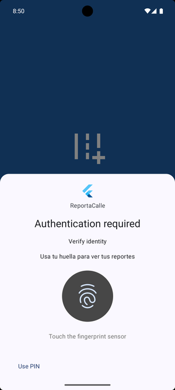
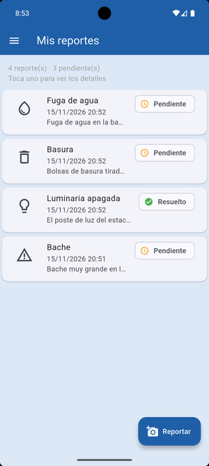
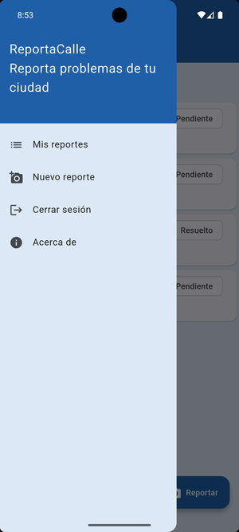
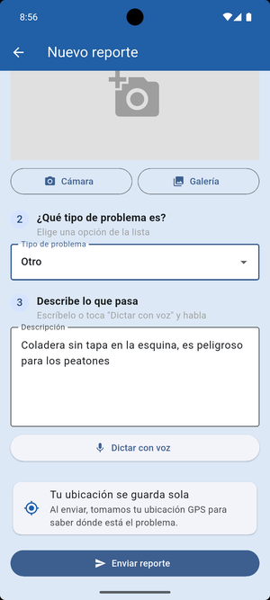
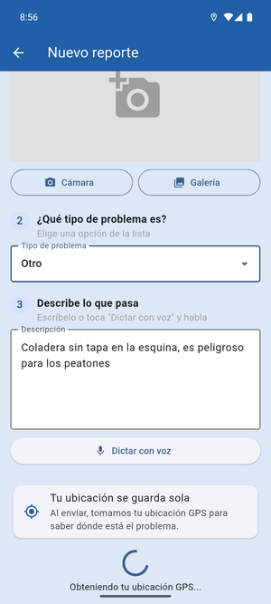
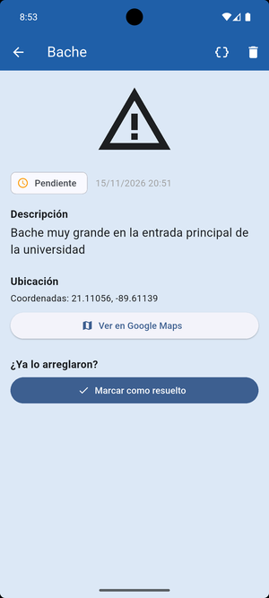
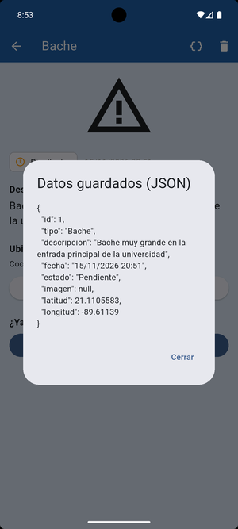
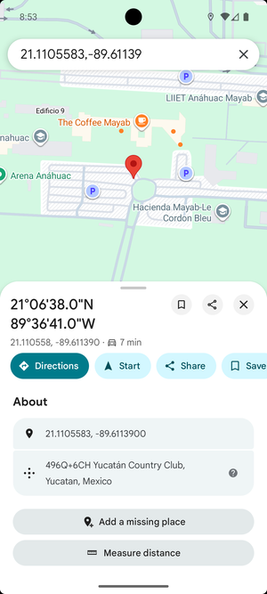
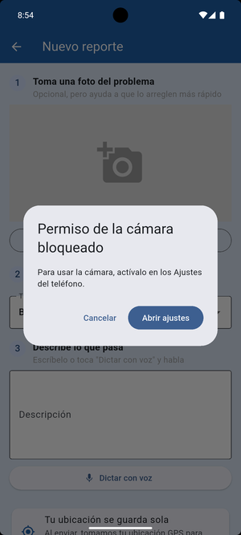

# ReportaCalle — Proyecto Ordinario

App de Flutter para **reportar problemas de la ciudad** (baches, luminarias apagadas, basura, fugas de agua). En cada reporte puedes:

-  Tomar una foto con la **cámara** o elegirla de la **galería**
-  **Dictar** la descripción con el micrófono (voz a texto)
- Guardar automáticamente la **ubicación GPS** y abrirla en **Google Maps**
-  Marcarlo como **Pendiente** o **Resuelto**
-  Entrar con **huella digital** (login biométrico)

Todo se guarda en el teléfono con **SQLite**, sin necesidad de internet.

## Capturas

Tomadas del emulador de Android Studio (Pixel 7, Android 15).

| Login con huella | Lista de reportes | Menú lateral |
|:---:|:---:|:---:|
|  |  |  |
| **Formulario (3 pasos)** | **Obteniendo el GPS** | **Detalle del reporte** |
|  |  |  |
| **Reporte en JSON** | **Ubicación en Google Maps** | **Permiso bloqueado** |
|  |  |  |

## Estructura del proyecto

```
lib/
├── main.dart                      Arranque de la app y rutas con nombre
├── models/
│   └── reporte.dart               Clase Reporte (datos + toMap / toJson)
├── database/
│   └── db_helper.dart             INSERT, SELECT, UPDATE y DELETE en SQLite
├── services/
│   ├── auth_service.dart          Login con huella
│   ├── permisos_service.dart      Pedir permisos y manejar si los niegan
│   ├── camara_service.dart        Cámara y galería
│   ├── voz_service.dart           Micrófono → texto
│   └── ubicacion_service.dart     GPS
├── widgets/
│   └── reporte_widgets.dart       Foto, etiqueta de estado e íconos por tipo
└── screens/
    ├── login_screen.dart          Pantalla de huella
    ├── inicio_screen.dart         Lista de reportes + menú lateral
    ├── nuevo_reporte_screen.dart  Formulario en 3 pasos
    └── detalle_screen.dart        Detalle + Google Maps + marcar resuelto
```

## Cómo ejecutarla (Android Studio)

1. Abrir la carpeta en **Android Studio** (con los plugins de Flutter y Dart).
2. Abrir el emulador: **Device Manager → ▶** (o conectar un celular con depuración USB).
3. Arriba, elegir el dispositivo **(mobile)** y presionar **▶ Run**.
4. En el emulador, la huella se simula con **⋯ → Fingerprint → Touch the sensor**.

## Requerimientos cubiertos

| Requerimiento | Dónde |
|---|---|
| Scaffold, AppBar y Drawer | `inicio_screen.dart` |
| Rutas con nombre y Navigator | `main.dart` (`/`, `/inicio`, `/nuevo`, `/detalle`) |
| Animación Hero | foto en `inicio_screen.dart` → `detalle_screen.dart` |
| SQLite (foto y coordenadas) | `db_helper.dart` |
| Serialización JSON | `reporte.dart` (`toJson` / `fromJson`) |
| try-catch | servicios y pantallas |
| FutureBuilder | `inicio_screen.dart` |
| Cámara y galería | `camara_service.dart` |
| Micrófono / dictado | `voz_service.dart` |
| GPS + Google Maps | `ubicacion_service.dart`, `detalle_screen.dart` |
| Login biométrico | `auth_service.dart`, `login_screen.dart` |
| Permisos denegados | `permisos_service.dart` |

El reporte técnico (diagrama de clases, flujo de datos y justificación) está en [docs/MO2. Parcial 2 Marcos Vidal.pdf](docs/MO2.%20Parcial%202%20Marcos%20Vidal.pdf).
